<p align="center">
  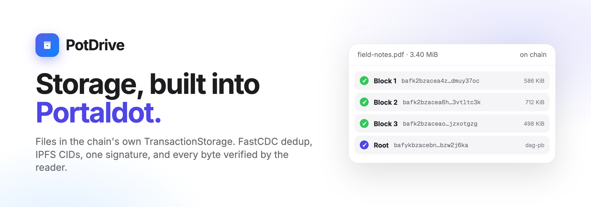
</p>

<h2 align="center">Native file storage for Portaldot</h2>

<p align="center">
  Portaldot V3 ships a storage pallet that nobody had used.<br>
  PotDrive turns it into a drive: content-addressed, deduplicated, one signature to store, and verified by every reader.
</p>

<p align="center">
  <a href="https://potdrive.anshverma.tech"></a>
  <a href="https://potdrive.anshverma.tech/docs"></a>
  <a href="#how-it-uses-portaldot-v3"></a>
</p>

<p align="center">
  
  
  
  
  
  
  
  <a href="https://dorahacks.io/hackathon/portaldot-hacker-house-2026/detail"></a>
</p>

<p align="center">
  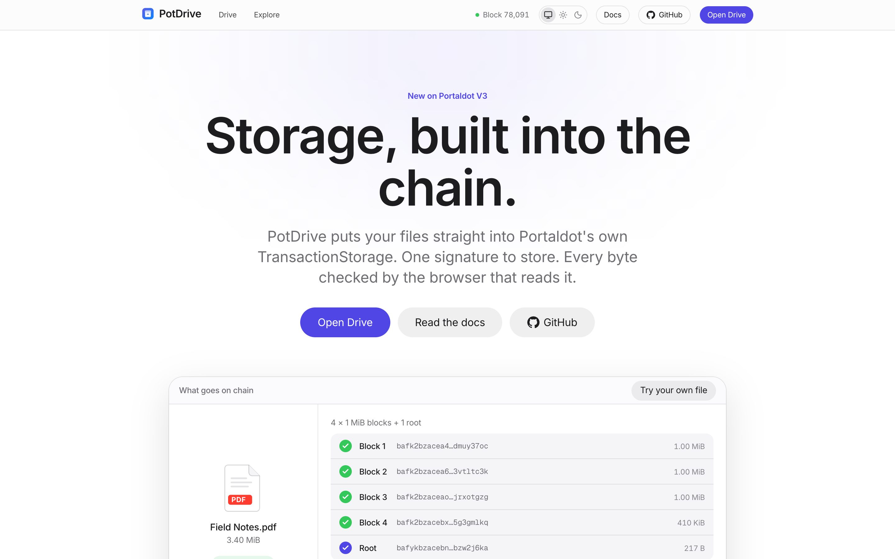
</p>

<p align="center">
  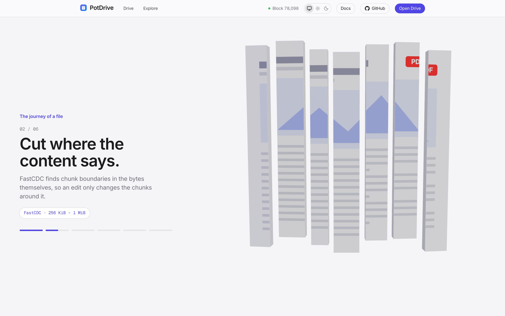
  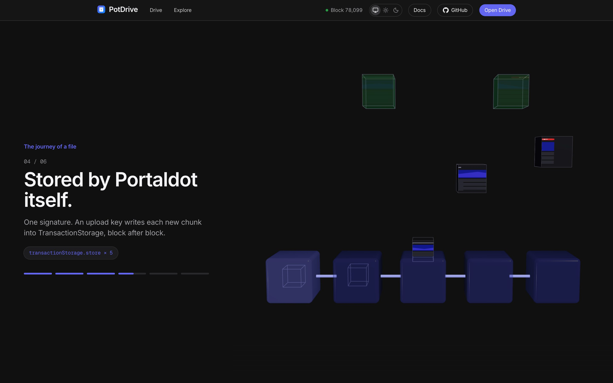
  <br><sub>The landing page follows one file from your disk to the chain and back, in 3D, as you scroll. Light and dark themes.</sub>
</p>

Portaldot V3 runs `TransactionStorage`, the pallet behind Polkadot's Bulletin chain. Any account can store data in it, block producers must keep proving they still hold that data, and the node serves it by content ID. When we checked chain state on 17 October 2026, it held **zero entries**. There was no SDK, no gateway and no app for it, and teams building on Portaldot were sending their files to outside IPFS pinning services.

PotDrive is the missing layer. Files are chunked by content (FastCDC), addressed with IPFS CIDs built on the exact hash Portaldot indexes, and stored with **one wallet signature**. Blocks the chain already holds are never paid for twice. Every reader (the Drive, the gateway, the SDK, the CLI and an MCP server for AI agents) re-hashes every block before trusting it.

| | |
|---|---|
| Live | **[potdrive.anshverma.tech](https://potdrive.anshverma.tech)**: Drive, file pages, network explorer |
| Docs | **[potdrive.anshverma.tech/docs](https://potdrive.anshverma.tech/docs)**: 21 pages, from concepts to API reference |
| Network | Portaldot V3 testnet · `wss://test-node-v3.portaldot.dev` · EVM chain id `420420777` |
| Registry | `PotDriveRegistry` on Revive: _deployed once test POT arrives_ (dry-run deploy verified, ≈ 224 tPOT deposit) |
| Package | `@potdrive/sdk` with React bindings at `@potdrive/sdk/react` |

### Hackathon

| Event | Track | Dates |
|---|---|---|
| **[Portaldot Hacker House 2026](https://dorahacks.io/hackathon/portaldot-hacker-house-2026/detail)** | Modular Cloud & Middleware | Check-in Oct 24 · Final Nov 6 · Demo Day Nov 8–9 |

---

## How it works

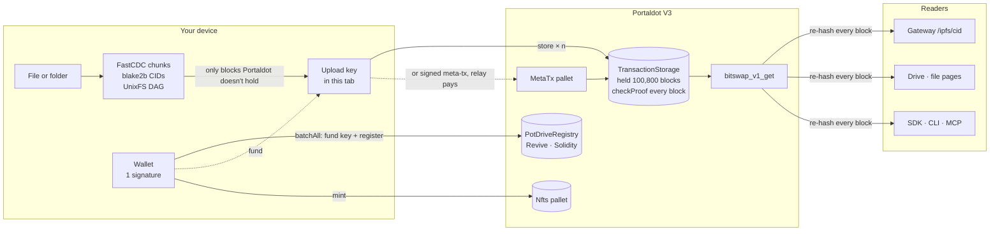

1. **Prepare, on your device.** The file is cut with FastCDC: boundaries follow the content, between 256 KiB and 1 MiB, averaging 512 KiB. Each chunk gets a CIDv1 whose multihash is `blake2b-256`, the exact digest TransactionStorage indexes. Files bigger than one chunk get a UnixFS `dag-pb` root. Folders become UnixFS directories. Private files are sealed with AES-256-GCM first.
2. **Deduplicate against the chain.** One state read lists every content hash Portaldot holds. Chunks it already has, from an older version, another file or another user, are linked instead of stored.
3. **Sign once.** One `utility.batchAll` funds a throwaway upload key and records the file in the registry. The node indexes each extrinsic's tail as a single entry, so chunks can't share a batch. The upload key signs one `transactionStorage.store` per new chunk, with no further prompts.
4. **Verify and return the change.** The root comes back over `bitswap_v1_get` and is re-hashed. Then the key sends its unspent budget home with `balances.transferAll`.
5. **Keep it alive.** Portaldot drops data after 100,800 blocks (about 7 days) unless someone calls `renew`. Prepaid keep-alive sits in the registry, and a daily keeper renews files before they expire. Anyone can fund any file.

### One upload, step by step

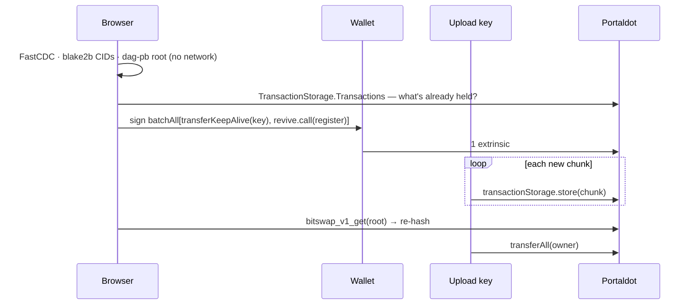

---

## How it uses Portaldot V3

Take any one of these out and PotDrive stops working.

| Runtime module | What it does in PotDrive |
|---|---|
| **TransactionStorage** (`store`, `renew`, `checkProof`) | Holds every chunk. Validators must prove a random 256-byte piece of each stored transaction one retention period later, or their block is invalid. |
| **Bitswap RPC** (`bitswap_v1_get`) | The read path for everything: Drive, gateway, SDK, CLI and MCP. It serves any CIDv1 whose multihash is a stored blake2b digest, so PotDrive CIDs are ordinary IPFS CIDs. |
| **Revive** (`instantiateWithCode`, `call`, `reviveApi`) | Runs `PotDriveRegistry`, plain EVM bytecode called from a Polkadot wallet in the same batch as the upload. It handles ownership, versions, prepaid keep-alive and sealed shares. |
| **Utility + Balances** (`batchAll`, `transferAll`) | Turn a many-transaction upload into one signature, and return the upload key's change. |
| **MetaTx + VerifySignature** (`dispatch`) | Gasless uploads: users with 0 tPOT sign once, and a relay pays for the meta-transactions. |
| **Nfts** (`create`, `mint`, `setMetadata`) | NFTs whose metadata and media both live on Portaldot. No collection existed on the V3 testnet before this. |

### Who can read what

| | Owner | Anyone with the link | A wallet you shared to | Everyone else |
|---|:-:|:-:|:-:|:-:|
| Public file | ✓ | ✓ | ✓ | ✓ |
| Private file: name, type, content | ✓ | ✓ (key in `#k=`) | ✓ (key sealed to their inbox) | ✕ |
| Private file: that it exists, its size | ✓ | ✓ | ✓ | ✓ |
| Your upload key | used for one upload, then swept | ✕ | ✕ | ✕ |

The `#k=` fragment is never sent to a server: not to PotDrive, the gateway or the RPC node.

---

## The product

<p align="center">
  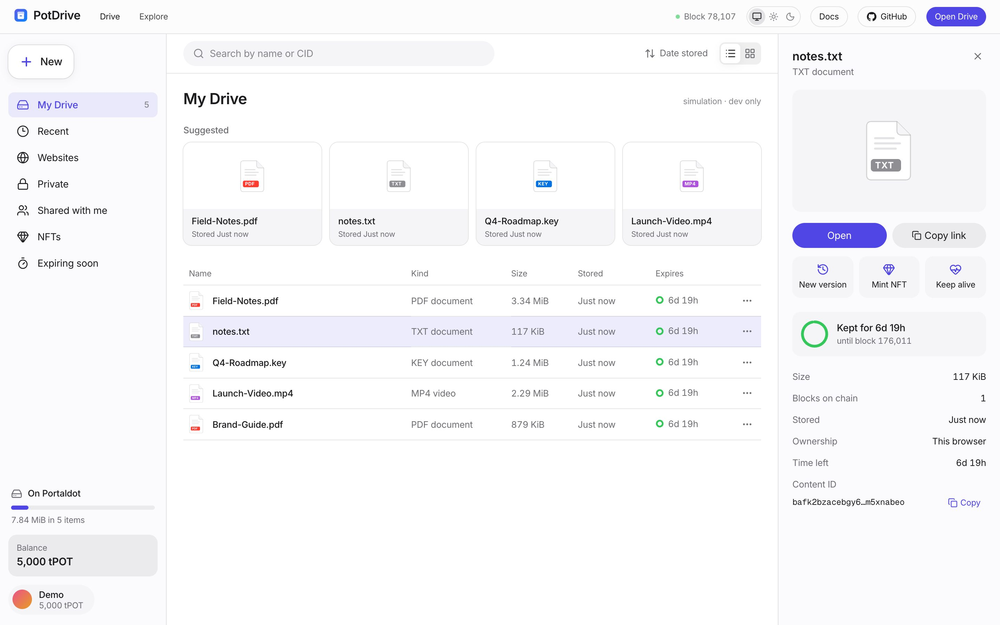
</p>

| | |
|---|---|
| **Drive** | Sections for My Drive, Recent, Websites, Private, Shared with me, NFTs and Expiring soon. Search by name or CID, sort, list or grid, a details panel, a right-click menu, and drag a file anywhere to upload. |
| **Upload sheet** | Shows what's new and what's already on chain, a fee estimate from `paymentInfo`, private on/off, keep-alive for 1, 5 or 13 weeks, and pay with your wallet or sponsored. |
| **Upload panel** | Starting an upload collapses it into a corner panel, Google Drive style, with live block-by-block progress. |
| **Versions** | Upload a new version of a file. Lists show the latest. The details panel shows v1, v2, v3. Each version only pays for changed chunks. |
| **Private files** | AES-256-GCM on your device. The name and type are sealed too. The key lives only in the link fragment. |
| **Share with a wallet** | Seal a private file's key to another address's X25519 inbox key. It shows up under their Shared with me. |
| **NFTs** | Mint any image on Portaldot's native Nfts pallet in one signature, and browse your NFTs in the Drive. |
| **Websites** | Upload a folder or run `potdrive deploy ./dist`. The gateway serves it at `/ipfs/<cid>/` in a sandboxed origin. |
| **File pages** | A big preview, plus a "Verified on this device" grid that fills block by block straight from the Portaldot node. Retention ring, details, and a button to fund keep-alive. |
| **Explore** | Everything TransactionStorage holds right now on a retention timeline, plus a storage-proof monitor for recent blocks. |

<p align="center">
  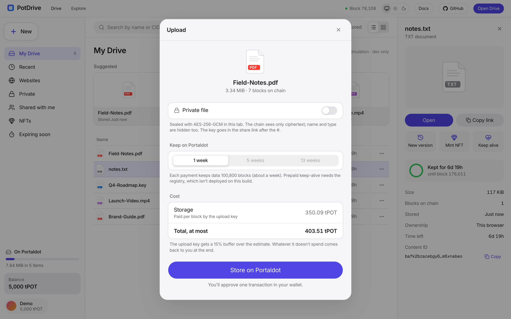
  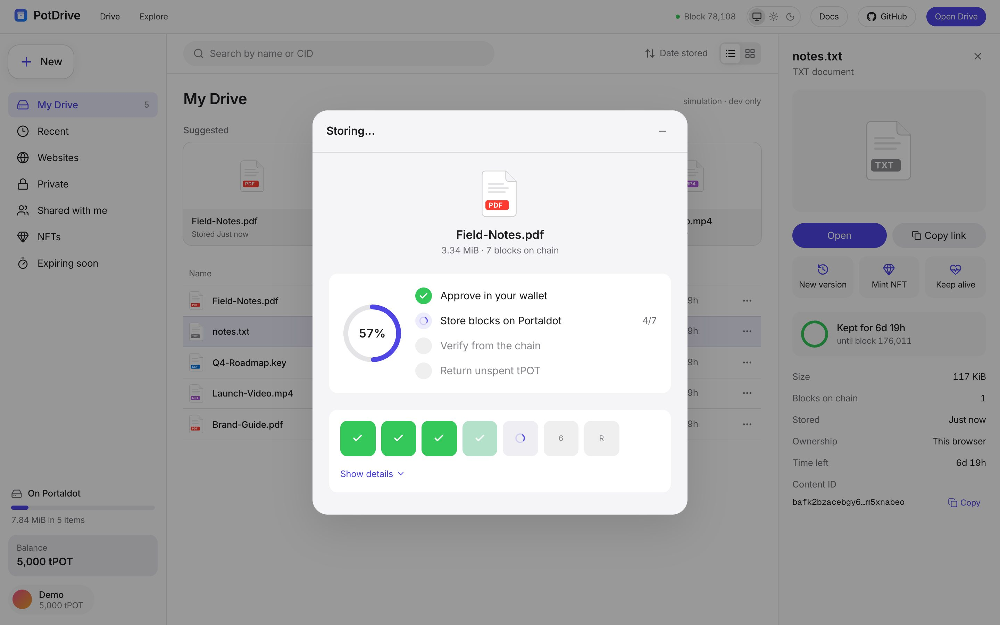
</p>
<p align="center">
  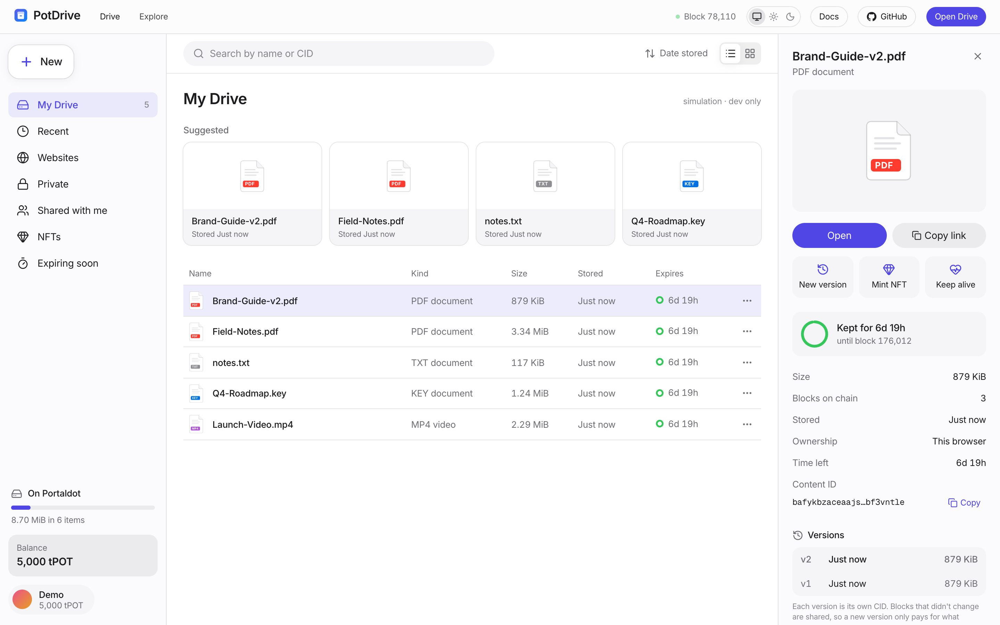
  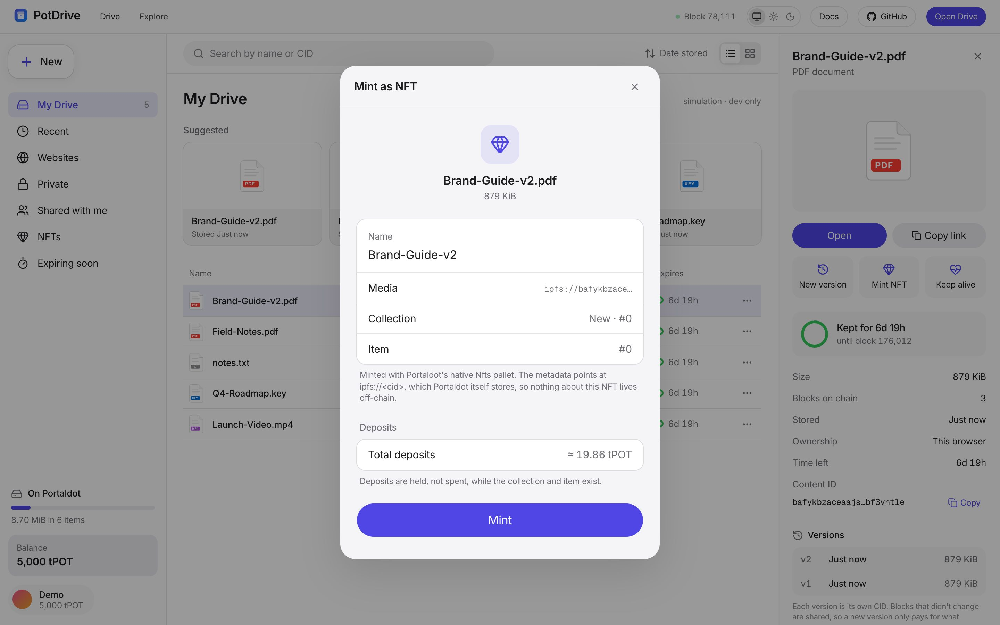
</p>
<p align="center">
  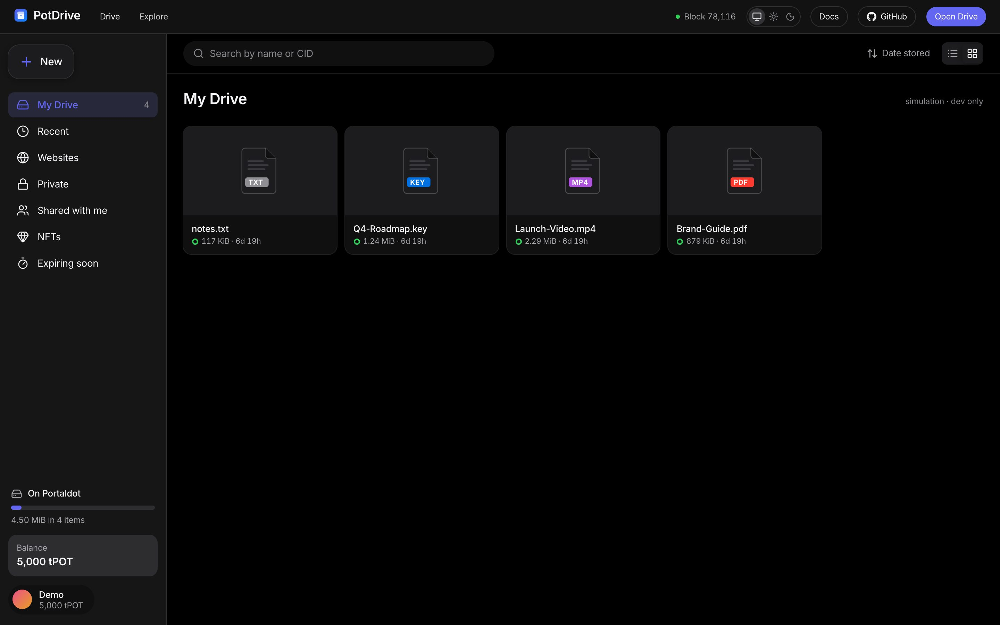
  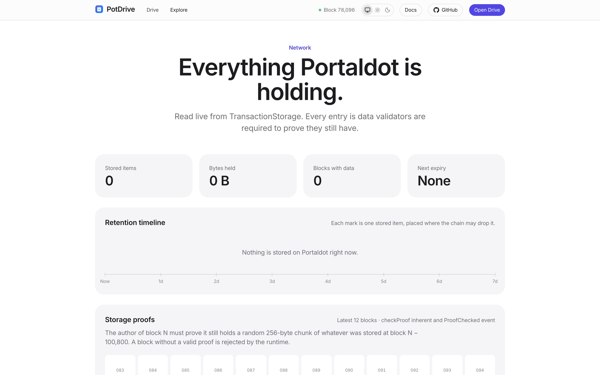
</p>
<p align="center">
  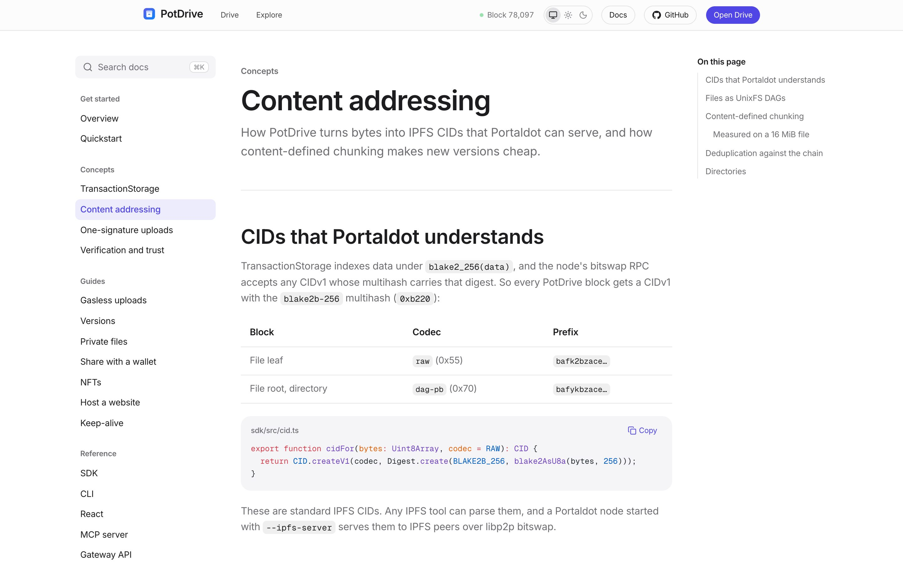
  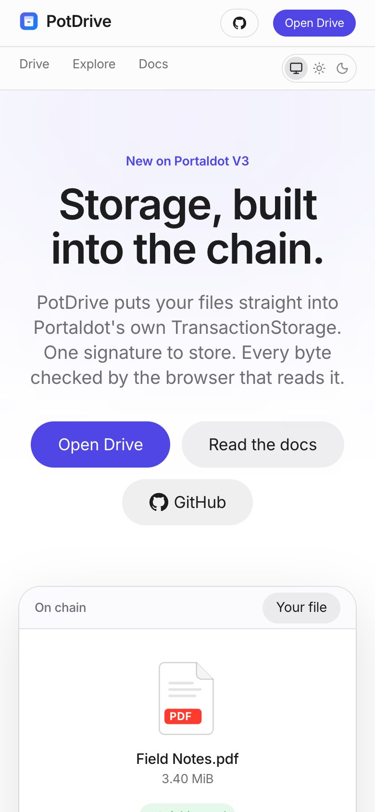
</p>

---

## Engineering notes

### Content-defined chunking pays for itself

Storage on the V3 testnet costs about **105 tPOT per MiB**, so re-storing unchanged bytes is the most expensive mistake a storage layer can make. With fixed-size chunks, one inserted byte shifts every later boundary. FastCDC (Xia et al., USENIX ATC 2016) with normalized chunking keeps boundaries anchored to content. Measured on a 16 MiB file (`bun scripts/bench-cdc.ts`):

| Edit | Fixed 1 MiB: new bytes | FastCDC: new bytes |
|---|---|---|
| Insert 1 KiB at 300 KiB | 16,385 KiB (100%) | **609 KiB (3.7%)** |
| Delete 10 KiB at 5 MiB | 11,254 KiB (68.7%) | **343 KiB (2.1%)** |
| Overwrite 4 KiB mid-file | 1,024 KiB (6.3%) | 898 KiB (5.5%) |
| Append 2 MiB | 2,048 KiB (11.1%) | 2,513 KiB (13.6%) |

### Things we found by reading Portaldot

- **Chunks can't share a batch.** `sc-client-db::apply_index_ops` keeps one index entry per extrinsic and stores the encoded extrinsic's last `size` bytes, hence the in-tab upload key.
- **Bytes must be passed as hex.** polkadot.js reads a raw `Uint8Array` passed as `Bytes` as already length-prefixed. Passed raw, `store()` would index the wrong data and fee estimates would price empty payloads. This was caught by a test before any tPOT was spent.
- **EVM constructors on Revive.** Arguments go on the end of the init code, and `data` must be empty, or you get `EvmConstructorNonEmptyData` (Revive error 54).
- **Deposits shape the contract.** Revive charges 0.06 tPOT per stored byte. Records are two packed slots, and names, versions and shares are event logs. With `via_ir` and `runs = 1`, the deploy deposit fell from about 578 to about 224 tPOT.
- **MetaTx signing.** The meta-tx pipeline is `(VerifySignature, MetaTxMarker, CheckNonZeroSender, CheckSpecVersion, CheckTxVersion, CheckGenesis, CheckMortality, CheckNonce, CheckMetadataHash)`, and the signature covers `blake2_256(version ‖ call ‖ explicit ‖ implicit)`. Browser wallets wrap raw messages in `<Bytes>`, so the wallet signs a readable authorization and the upload key signs the meta-txs.

---

## Verified

- `bun test sdk`: **34 tests**.
  - CIDs match `blake2b-256` exactly as TransactionStorage indexes it.
  - DAGs and directories are deterministic, with sorted links and path-traversal rejection.
  - FastCDC respects its bounds and re-uses chunks after edits where fixed chunking doesn't.
  - The private envelope round-trips, and a wrong key fails cleanly.
  - Wallet shares open only for the right inbox and are bound to their file root.
  - Sponsor authorizations accept raw and wallet-wrapped signatures and reject a tampered budget.
  - NFT metadata stays under the 256-byte limit.
- `sdk/test/read.test.ts` runs the **entire read path against a fake Portaldot node**. That covers multi-chunk reassembly, range reads fetching only the needed chunks, stitching across chunk boundaries, refusing tampered bytes, and resolving folder paths.
- `cd contracts && forge test`: **12 tests**. They cover ownership, expiry, private-by-default listing, re-registration, keeper reimbursement and its cap, owner-only withdraw, transfers, version links, inbox keys and owner-only sharing.
- **Gateway end to end** (`scripts/fake-node.ts` plus `POTDRIVE_RPC_URL`):
  - The directory redirect works and serves `index.html`.
  - `206` partial responses are byte-exact, including suffix ranges, plus `416`, `404` and downloads.
  - A stored site runs with an **opaque origin** (`window.origin === "null"`), and its `localStorage` access throws `SecurityError`.
- **Against the live testnet:**
  - Fees measured with `paymentInfo`.
  - The registry deploy dry-run passes through `reviveApi.instantiate`.
  - Meta-transactions encode, decode and recover their signer.
  - The proof monitor reads real blocks.
- `bun scripts/ui/readme-shots.ts` retakes every image in this README with Playwright, and fails on any page error.

**Not yet on chain:** the first real `store`, the registry deployment and the relay all wait on test POT from the Portaldot team. This section will list their transaction hashes.

## Repository

```
sdk/src/            TypeScript SDK
  cdc.ts            FastCDC (normalized), fixed gear table
  cid.ts dag.ts     blake2b CIDs, UnixFS files and directories
  upload.ts         one-signature upload, chain-level dedup, upload key, sweep
  fetch.ts          verified reads, range reads, path resolution
  metatx.ts         MetaTx payloads; sponsored.ts: gasless upload client
  share.ts          X25519 + HKDF + AES-GCM sealing to inbox keys
  nft.ts            native Nfts pallet minting
  registry.ts       Revive registry reads (eth_call, eth_getLogs) and calls
  renew.ts keeper.ts proofs.ts state.ts
sdk/react/          usePotFile, <PotImage>, <PotVideo>
sdk/test/           34 tests, including a fake-node read path
contracts/          PotDriveRegistry.sol + Foundry tests
src/app/            Next.js: landing, /drive, /f/[cid], /explore, /docs (21 pages)
src/app/ipfs/       IPFS-style gateway with Range, directories, sandboxing
src/app/api/        file metadata, chain state, proofs, keeper cron, MetaTx relay
cli/potdrive.ts     put · get · deploy · info · renew · ls
mcp/server.ts       MCP server for AI agents
scripts/            deploy, CDC benchmark, fake node, README screenshots
```

## Run it

```bash
bun install
bun run dev                          # http://localhost:3000  (/drive?simulate replays an upload, dev only)

# checks
bun test sdk
cd contracts && forge test && cd ..
bun scripts/bench-cdc.ts

# CLI
export POTDRIVE_SEED="twelve words …"
bun cli/potdrive.ts put ./deck.pdf --private
bun cli/potdrive.ts deploy ./dist
bun cli/potdrive.ts get <cid> -o deck.pdf

# deploy the registry (≈ 224 tPOT refundable code deposit)
POTDRIVE_SEED="…" KEEPER_SEED="…" bun scripts/deploy.ts
```

Site environment: `NEXT_PUBLIC_REGISTRY`, `NEXT_PUBLIC_REGISTRY_BLOCK`, `KEEPER_SEED`, `CRON_SECRET`, `RELAYER_SEED`, `RELAY_MAX_BYTES`.

## Limits

- **Testnet only.** Storage costs about 105 tPOT per MiB on the V3 testnet, mostly the length fee.
- **Retention, not permanence.** Data lasts 100,800 blocks per payment. Keep-alive automates renewals, but someone has to fund them.
- **One RPC is trusted for availability and chain state.** Integrity is checked by every reader. A light client would remove the rest.
- **The keeper is a trusted operator.** Its claims are capped per file and public, but the contract can't see native-side renewals.
- **Inbox keys live in one browser.** Losing one loses access to files shared with you, not your own uploads.

MIT licensed.
