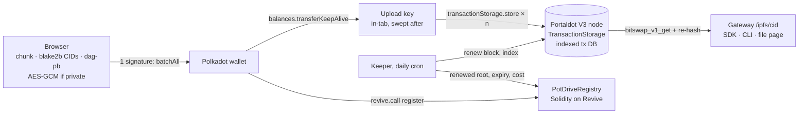

# PotDrive

**Portaldot already had storage built in. PotDrive makes it one click.**

PotDrive is storage middleware for Portaldot V3. It writes files straight into the chain's own `TransactionStorage` pallet, gives every file a standard IPFS CID, and reads it back through the node's bitswap RPC with every block re-hashed by the reader. Ownership and prepaid renewals live in a small Solidity registry on Revive.

- **Live:** https://potdrive.anshverma.tech
- **Track:** Portaldot Hacker House 2026 · Modular Cloud & Middleware
- **Network:** Portaldot V3 testnet (`wss://test-node-v3.portaldot.dev`, EVM chain id `420420777`)

## Why

Portaldot V3 ships `TransactionStorage`, the pallet behind Polkadot's Bulletin chain. Anyone can call it, block producers must keep proving they hold the data, and the node serves it by CID. When we checked chain state on 17 October 2026 it held **zero** entries: no SDK, no gateway, no UI, no guide. Projects on Portaldot were sending files to outside IPFS pinning services instead.

PotDrive turns that unused pallet into a product:

| | |
|---|---|
| **Versions** | New versions link to their parent; FastCDC + dedup means v2 only pays for changed blocks. |
| **Gasless uploads** | Users with 0 tPOT sign one authorization; a relay pays via Portaldot's **MetaTx** pallet. |
| **Share with a wallet** | Private file keys sealed to a recipient's X25519 inbox key (HKDF + AES-GCM), emitted as a `Shared` event. |
| **Native NFTs** | Mint on Portaldot's **Nfts** pallet in one batch; media stored in TransactionStorage. |
| **SDK + React + MCP** | npm-ready `@potdrive/sdk` with `usePotFile` / `<PotImage>`, and an MCP server for AI agents. |
| **One signature per upload** | Your wallet signs one `utility.batchAll`: fund an in-tab upload key + register the file. The key stores each block and returns its unspent balance. |
| **Real IPFS CIDs** | 1 MiB raw leaves + a UnixFS `dag-pb` root, all hashed with blake2b-256, the digest TransactionStorage indexes. |
| **Verified reads** | Browser, SDK, CLI and gateway re-hash every block from `bitswap_v1_get` before using it. |
| **Private files** | AES-256-GCM in the browser before upload. Name and type are sealed too; the key lives only in the link fragment. |
| **Keep-alive** | Prepay renewals in the registry; a daily keeper calls `renew` and is reimbursed exactly the fee, capped per file. |
| **Explorer** | Everything `TransactionStorage` holds right now, read from chain state, on a retention timeline. |

## Architecture



Why one transaction per block: the node's database indexes the **tail** of each extrinsic, one entry per extrinsic (`sc-client-db::apply_index_ops`). Two `store` calls in one batch would index the wrong bytes, so blocks are separate transactions signed by the upload key.

## Portaldot V3 features used

| Pallet / API | Used for |
|---|---|
| `TransactionStorage` (`store`, `renew`, `checkProof`) | Holding file blocks; renewing; validators' storage proofs |
| `bitswap_v1_get` RPC | Content-addressed reads for every client |
| `Revive` (`instantiateWithCode`, `call`, `reviveApi.*`) | Registry deployed as EVM bytecode, called from a Polkadot wallet; H160 mapping |
| `Utility.batchAll`, `Balances.transferAll` | One-signature uploads; returning unspent upload budget |
| Revive Ethereum RPC (`eth_call`, `eth_getLogs`) | Reading the registry and its logs |
| `MetaTx` (`dispatch`) + `VerifySignature` | Sponsored (gasless) uploads through a relay |
| `Nfts` (`create`, `mint`, `setMetadata`) | NFTs whose media lives on Portaldot |

## Repo

```
sdk/src        TypeScript SDK (CIDs, DAG, envelopes, upload, fetch, renew, registry, keeper)
sdk/test       bun tests
contracts      PotDriveRegistry.sol + 12 forge tests (via-ir, ~3 KB runtime)
src/app        Next.js site: landing, /drive, /f/[cid], /explore, /docs
src/app/ipfs   IPFS-style gateway route
src/app/api    file metadata, chain state, keeper cron
cli            potdrive CLI (bun)
mcp            MCP server for AI agents (read, store, deploy)
sdk/react      React bindings: usePotFile, <PotImage>, <PotVideo>
scripts        registry deployment through pallet-revive
```

## Run it

```bash
bun install
bun run dev                     # http://localhost:3000
bun test sdk                    # 34 SDK tests
cd contracts && forge test      # registry tests

# CLI
export POTDRIVE_SEED="twelve words ..."
bun cli/potdrive.ts put ./file.pdf --private
bun cli/potdrive.ts get <cid> -o out.pdf --key <k>
bun cli/potdrive.ts ls

# Deploy the registry (≈224 tPOT refundable code deposit)
POTDRIVE_SEED="..." KEEPER_SEED="..." bun scripts/deploy.ts
```

Environment for the site: `NEXT_PUBLIC_REGISTRY`, `NEXT_PUBLIC_REGISTRY_BLOCK`, `KEEPER_SEED`, `CRON_SECRET`.

## Testnet deployment

| | |
|---|---|
| Registry contract | _pending: deployed once test POT arrives_ |
| Deploy transaction | _pending_ |
| First stored file | _pending_ |

## Measured numbers (V3 testnet, 17 Oct 2026)

- Retention: 100,800 blocks per store or renew (~7 days)
- Max 8 MiB per `store`; PotDrive uses 1 MiB blocks
- Fee ≈ 0.11 tPOT per KiB, ≈ 105 tPOT per MiB (length fee dominates); renew costs the same
- Registry deployment deposit ≈ 224 tPOT

## License

MIT
